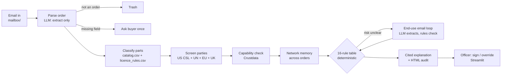

# Clearance

**An autonomous export-compliance officer for Indian electronics exporters.** Built for ContextCon (Crustdata × YC), theme *"Services, Replaced"*.

An order for sensitive electronic parts (FPGAs, high-speed ADCs, RF and mmWave amplifiers) arrives by email. Clearance reads it, classifies the parts, screens every party against the official restricted lists, checks with Crustdata whether the buyer could really use what it is buying, asks the buyer for an end-use statement when needed, and recommends **RELEASE**, **LICENCE_REQUIRED**, **HOLD** or **BLOCK**. Every recommendation cites its evidence. A named officer signs every release and every block.

---

## The service

**The job.** Before an Indian exporter ships controlled electronics, someone has to answer three questions for every order:
1. **Is the part controlled?** Under India's SCOMET list (DGFT) and, for US-origin parts, the US EAR (for example ECCN 3A001).
2. **Is anyone on the order banned?** The buyer, the ship-to party, any middleman and the freight forwarder, checked against the US, UN, EU and UK restricted lists.
3. **Does the buyer make sense?** The US Commerce Department's "Know Your Customer" red flags: a quantity the company could not use, an end use that doesn't fit its business, a forwarder as the final destination, evasive answers about the end use.

**Who does it today.** A trade-compliance officer at the exporter, or an outside trade-compliance consultant or law firm. They run list-screening software, look the buyer up by hand (website, LinkedIn, registries), email the buyer for an end-use certificate, chase vague answers, and write a file that can survive an audit. That takes from hours to days per order. Rings that split one controlled system across several small "routine" orders are almost never caught, because each order is reviewed on its own.

**Who pays.** The exporter: salaried compliance staff, consultant fees per review, and screening-software subscriptions. The cost of getting it wrong is much larger: export privileges revoked, penalties, and being added to a list yourself.

---

## What it does now

End to end, with no one stepping in, from the email arriving to a signed decision:

| Step | What Clearance does |
|---|---|
| **Read the order** | Pulls buyer, ship-to, middleman, forwarder, parts, quantities and countries out of a free-text email. If a required field is missing, it emails the buyer once for exactly that field. Irrelevant mail ("Vbucks?") goes to **Trash**: no order and no reply. |
| **Identify the buyer** | Uses the sender's corporate email domain (free-mail is ignored) to find the company in Crustdata. |
| **Classify the parts** | Matches each part number (or datasheet wording such as "77 GHz GaAs power amplifier") against the catalog to get the ECCN, the SCOMET category and whether a licence is needed for that destination. An unknown part is never guessed: the order is held. |
| **Screen every party** | Checks names, aliases and addresses against about **22,300 entities**: the US Consolidated Screening List (18,598) plus the UN (274), EU (1,779) and UK (1,667) lists. Fuzzy matching catches misspellings. A specific listed address is a match even under a new company name. |
| **Capability check (Crustdata)** | Pulls company size, headcount by function, growth, web traffic, a sample of employees (titles, skills, past employers) and about 20 peer companies. It then asks whether this company could use this quantity of these parts: technical staff compared with the quantity ordered, engineering share compared with peers, staff size, and real manufacturer or reseller judged from the people rather than from keywords. |
| **Network memory** | Remembers every order. If several buyers share a director, address or forwarder and together have ordered most of a controlled system (for example a radar seeker front-end), all of those orders are held and the earlier ones get an alert. Employees' past employers are also screened, so staff who came from a listed entity are flagged. |
| **End-use loop** | When the risk is unclear, Clearance emails the buyer for an end-use statement, checks the answer against the parts and the company, and sends one targeted follow-up if the answer is vague. Evasive twice means **HOLD**. |
| **Decide** | A fixed, ordered table of 16 rules picks the outcome (for example R1 exact list match → BLOCK, R6 no company data → HOLD, R12 all checks passed → RELEASE). |
| **Explain and file** | Writes a plain-English explanation in which every sentence cites evidence IDs (`E1`, `E2`, …) with their source and fetch date, and produces an HTML audit file. |

**Where it still needs a person, and why:**
- **Signing.** A named officer signs every RELEASE and BLOCK. Export law puts the liability on a person, so the product does the investigation and the person carries the signature.
- **Exceptions.** HOLDs (close list matches, no company data, evasive buyers, linked rings) land in an *Exceptions* queue with all the evidence side by side. The officer decides, and can **override** any recommendation with a reason, which is logged.
- **What it cannot check, it says so.** The India DGFT denied-entity list has no bulk download (only per-IEC lookup), so every Indian party's file says *"DGFT denied-entity status was not checked"*. No Crustdata record → *"no company data"* → HOLD, never a guess. Crustdata or the LLM down → HOLD with the reason.

**Robustness built in:**
- **Retries:** Crustdata timeouts and rate limits are retried, then reported.
- **Resuming:** an order interrupted mid-check resumes on the next poll.
- **Never twice:** an email is never processed twice, an end-use request is never sent twice, and a re-sent identical order joins the first one instead of opening a duplicate.
- **Fresh data:** cached Crustdata data older than 7 days is fetched again. Ban lists show their download date and are flagged when they are older than 7 days.

---

## What it could do in the future

**Next, with more time:**
- **Real mailbox and ERP.** IMAP or Gmail in place of the folder mailbox, and pushing the signed decision into the exporter's ERP and shipping documents.
- **Licence filing.** Draft the SCOMET licence application and the end-user certificate from the evidence file, ready for the officer to submit.
- **Shipping-document checks.** Compare the commercial invoice, packing list and airway bill against the approved order (same consignee, same quantities, same route).
- **Payment red flags.** Use the bank or payment data (payer in a third country, unusual premium). The rule for these exists (R5b), but nothing feeds it real payment data yet.
- **Live monitoring.** Crustdata watchers re-rate a signed customer when its headcount, leadership or news changes. The code is there; it needs a public webhook URL to run.

**Why not now:**
- **No data source yet:** there is no bulk DGFT denied-entity list.
- **Filing needs a person:** licence filing needs the exporter's digital signature and legal sign-off.
- **Systems we don't have:** document and payment checks need access to the exporter's systems, which a hackathon prototype doesn't have.
- **We chose depth:** in 8 hours we put the time into getting the decision right and fully cited rather than adding more channels.

---

## The future of this service

Compliance becomes **continuous and network-wide** instead of per order and per company:
- **The agent does the whole investigation.** It classifies, screens, checks capability, chases the end-use statement and files the licence. The human compliance role shrinks to the exceptions and the signature the law requires.
- **Every customer is watched all the time,** not just checked once at onboarding. A buyer that starts to look like a shell is re-rated the day it changes.
- **Memory across exporters.** With privacy-preserving sharing of the order patterns, a ring that splits a radar front-end across five Indian exporters becomes visible. Today no single exporter's compliance team can see that.
- **Compliance becomes a feature of the order,** not a department: a small exporter gets the diligence of a large defence supplier for the price of software.

---

## How to run it

### Requirements

| What | Notes |
|---|---|
| Python | 3.10 or newer |
| [Ollama](https://ollama.com) | Runs the local LLM. Default `qwen3:8b` (about 5 GB); `qwen3.5:4b` also works. Run `ollama serve` from your own terminal (it needs the GPU) |
| Crustdata API key | Optional. Without it, only the synthetic demo companies (fixtures) are known |
| Anthropic API key | Optional. Only if you switch the LLM to Claude |

### Setup

```bash
git clone https://github.com/PradyumnVikram/contextcon_yc.git
cd contextcon_yc
python3 -m venv .venv && source .venv/bin/activate
pip install -e ".[data,product,dev]"

ollama pull qwen3:8b                 # once; keep `ollama serve` running
cp .env.example .env                 # add CRUSTDATA_API_KEY to use live data

python -m clearance.screening.csl    # US Consolidated Screening List -> data/csl.csv
# UN / EU / UK lists (download links in data/csl_manifest.txt), then:
python scripts/build_sanctions_extra.py un.xml eu.csv uk.csv   # -> data/sanctions_extra.csv

pytest                               # 113 passed, fully offline
```

| `.env` variable | Default | Purpose |
|---|---|---|
| `CLEARANCE_LLM` | `ollama` | `ollama` (local) or `claude` |
| `OLLAMA_MODEL` | `qwen3:8b` | Any Ollama model with structured output |
| `CRUSTDATA_API_KEY` | (empty) | Live Crustdata. Empty means demo fixtures only |
| `ANTHROPIC_API_KEY` | (empty) | Only with `CLEARANCE_LLM=claude` |
| `CLEARANCE_DB` | `clearance.db` | SQLite: orders, evidence, emails, API caches |
| `CLEARANCE_MAILBOX` | `mailbox` | Simulated inbox and outbox folders |
| `CLEARANCE_WEBHOOK_URL` | (empty) | Public URL for Crustdata watcher callbacks |

### Run the two-window demo

```bash
python -m clearance.reset_demo                    # clear orders and mail, KEEP the paid Crustdata cache
streamlit run app.py                              # Clearance officer screen -> http://localhost:8501
streamlit run buyer_app.py --server.port 8502     # buyer mail client        -> http://localhost:8502
```

In the buyer window pick **Write as**, then **Send**. Clearance processes the email within a few seconds (auto-process is on), and any email it sends back appears in the buyer's inbox, where you can **Reply**. In the officer screen: **Inbox** (orders, conversation, Trash), **Processing** (Checks · Crustdata · Network · Evidence), **Action** (recommendation, Sign, Override, audit file, queues). Type an officer name in the sidebar to sign.

| Write as | Expected |
|---|---|
| **Astra Microwave (REAL)** | Live Crustdata by domain, clear on all lists, consistent with real peers → **Release**. Sign it |
| **Data Patterns (REAL)**, to Germany | **Licence required**, with the documents to collect |
| **Synthetic shell Traders** | Capability mismatch → end-use request. Reply "civilian use only" → one follow-up. Vague again → **Hold** |
| **Synthetic nodata Enterprises** | No company data → **Hold** with an end-use request |
| **Listed Electronic Tradng** | Close spelling of a listed entity → **Hold**, both names side by side |
| **Ring 1 → 2 → 3** (in order) | Each looks routine alone. Ring 3 completes a radar seeker front-end across buyers sharing a director and forwarder → all three **Hold**, earlier two alerted |
| **Synthetic Apex Components** | Managing director came from a listed entity → **Hold** |
| **Custom address…**, "Vbucks?" | Not an order → **Trash**, no reply |

> **Ethics rule:** real companies appear only as legitimate buyers. Every suspicious and listed scenario uses synthetic companies.

Headless: `python -m clearance.worker` processes the mailbox and prints each decision. Check the Crustdata key and balance with `python -m clearance.crustdata_client`. The first live check of a new company costs about 70 credits; repeats come from the cache.

### Troubleshooting

| Symptom | Fix |
|---|---|
| Every order is **HOLD (R10)** | The LLM isn't reachable. Run `ollama serve` in your own terminal and check `OLLAMA_MODEL` is pulled, or use `CLEARANCE_LLM=claude` |
| Sidebar says "Screening list · demo only" | Download the lists (setup above) |
| A company shows "no data" | No `CRUSTDATA_API_KEY`, or Crustdata has no record of it (which is itself a HOLD) |
| `pytest` crashes importing `launch` or `yaml` | A system install is injecting plugins: `env -u PYTHONPATH pytest` |

---

## How it's built



**The one design rule: the LLM never decides.** It does three jobs: reading emails into structured fields, drafting emails to the buyer, and writing the explanation. Every explanation sentence must cite real evidence IDs, and the validator rejects any that don't. The outcome always comes from the rules table and the numeric capability score, so the same facts always give the same decision.

| Part | What it is |
|---|---|
| **Orchestrator** | `clearance/pipeline.py`: one state machine per order (EMAIL_RECEIVED → PARSED → CLASSIFIED → SCREENED → CAPABILITY_CHECKED → [AWAITING_END_USE] → RECOMMENDED → SIGNED). The only module that calls the others |
| **Models** | Local **Ollama** (`qwen3:8b` by default), so customer data stays on the machine, or **Claude** via `CLEARANCE_LLM=claude`. Structured output against Pydantic schemas, with one retry, then HOLD (R10) |
| **Crustdata calls** | `clearance/crustdata_client.py`, called from `capability/` and `network/`: `/company/enrich` (company record, headcount by function, growth, traffic, hiring, news), `/company/search` (peer set), `/person/search` (employee sample with titles, skills, past employers), `/watch/company` (monitoring signed customers). Throttled per endpoint, retried on 429/5xx and timeouts, cached in SQLite for 7 days |
| **Restricted lists** | `clearance/screening/`: fuzzy name, alias and address matching over the US CSL plus the UN/EU/UK files (`data/csl.csv`, `data/sanctions_extra.csv`, git-ignored; sources in `data/csl_manifest.txt`) |
| **Scoring** | `clearance/capability/`: points that fade in smoothly (no hard cliffs), tiers *consistent* < 30, *medium* 30–59, *high* ≥ 60; missing or thin data gives *no_data* (HOLD). All weights are in `clearance/config.py` |
| **State** | One SQLite file (`clearance.db`): orders, state history, evidence, emails, customers, network links, and caches for the API, people, peers and LLM. Mail is a folder of `.eml` files (`mailbox/inbox`, `mailbox/outbox`) |
| **UI** | Streamlit: `app.py` (officer screen) and `buyer_app.py` (simulated buyer mail) |
| **Runs on** | One laptop. Python 3.10+, SQLite, Ollama. No server or cloud needed beyond the Crustdata API |

```
clearance/
  pipeline.py      order state machine          models.py, evidence.py, store.py, config.py  shared contracts
  mail/            mailbox, parsing, Trash      crustdata_client.py   cached, throttled Crustdata client
  catalog/         parts + licence rules        screening/            restricted-list matching
  capability/      buyer can-use-it scoring     network/              memory across orders
  enduse/          end-use request + checks     decision/             rules table, explanation, audit
  llm/             Ollama / Claude adapters     watch/                Crustdata watchers + webhook
app.py, buyer_app.py   the two windows          data/   catalog, lists, systems, demo fixtures
tests/                 113 offline tests (fake LLM, mocked HTTP, fixtures)
```

More detail: [`WORKFLOW.md`](WORKFLOW.md) (module map and checkpoints), [`OFFICER.md`](OFFICER.md) (the officer's workflow, every scoring change and the officer-screen spec), [`AGENTS_DATA.md`](AGENTS_DATA.md) and [`AGENTS_PRODUCT.md`](AGENTS_PRODUCT.md) (the two build briefs).

---

## The approaches you tried

**What didn't work, and what we did instead:**

| Tried | Problem | Now |
|---|---|---|
| A "find the most reachable person" outreach tool (our first idea) | A useful tool, but not a service a business pays a person to do; and Crustdata has no connection graph | Switched to export compliance: a real paid job with real liability, where Crustdata's company and people data is the missing evidence |
| Letting the LLM judge the risk | Not repeatable or auditable, and a small local model is inconsistent | The LLM only extracts, drafts and explains; a fixed rules table decides; every sentence must cite evidence |
| Deciding manufacturer vs distributor from description keywords | Digi-Key's industry label is "Electronics Manufacturing", so it was scored as a manufacturer with too few engineers → high risk | Decided from the people: engineering share and the employee sample, with the description only as a tie-breaker |
| Hard cut-offs ("< 50 staff = +25 points") | One employee either side of a line flipped the outcome | Points fade in smoothly (for example small-staff points fade to zero at 80 people) |
| Penalising young companies, low web traffic, small distributors and transshipment countries | Validated on 25 real companies (Analog Devices, TI, Infineon, NXP, BEL, Tejas, Digi-Key, Mouser, Arrow…): these flagged legitimate firms, and the data is often missing for real ones | Tracked and shown to the officer, but not scored |
| "Units per engineer" against total headcount | Large firms always looked fine and small labs always looked suspicious | Quantity is compared with **technical** headcount; zero points at a reasonable amount, full points at 5× it |
| Any address match = exact hit = BLOCK | Every buyer shipping to "Jebel Ali Free Zone, Dubai" was blocked | Only a specific listed address (with a unit or plot number) matches, and an address-only match is a HOLD for the officer |
| Sorting the Crustdata person search by seniority | The API returned 400 (not a sortable field) | Sample without a sort |
| Crashing on a Crustdata timeout | The order was stuck forever, half-checked | Retry, then HOLD with "lookup unavailable"; interrupted orders resume |

**What worked:**
- **Crustdata's people data:** employee titles, skills and past employers tell a real RF engineering firm apart from a trading shell far better than the company description does. Past employers also caught staff who came from a listed entity.
- **Peer comparison:** comparing each buyer with about 20 Crustdata peers instead of fixed thresholds kept large and small legitimate companies inside the consistent band.
- **Memory across orders:** linking buyers by a shared director, address or forwarder, and matching their parts against controlled-system templates (`data/systems.csv`), catches rings that per-order review cannot.
- **The end-use loop:** one targeted follow-up separates a confused buyer from an evasive one without bothering legitimate customers.

**The hardest case:** a ring of three small buyers, each ordering a routine quantity of a different part, shipping through the same Dubai forwarder. No single order is suspicious, but together they make a radar seeker front-end. That is why network memory exists.

---

*Prototype for a hackathon. Not legal advice. In any real deployment, a qualified person reviews and signs every decision and licence application. All suspicious demo companies and demo listed entities are synthetic.*
